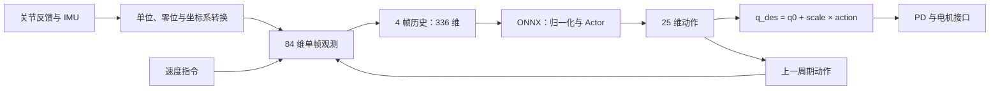

# Hunter130 神经网络部署文档

本文说明如何把 AMP_mjlab 的 Hunter130 策略接入 ONNX 推理和机器人控制循环，重点是训练、推理和电机接口之间的数据一致性。适配与动作数据准备见 [Hunter130 说明](hunter130.md)。

本文以 **`Hunter130-AMP-Flat`、25 关节、336 维输入**为主，参数根据本仓库代码及训练目录 `logs/rsl_rl/hunter130_amp_locomotion/2026-10-13_13-54-20/` 的实际 ONNX 和保存配置核对。其他任务的差异在末尾列出。代码片段均为离线推理参考；本文没有修改或完成外部实机控制器的适配。

## 1. 部署接口概览

| 项目 | 当前 AMP 平地策略 |
|---|---|
| 模型 | `policy.onnx`，ONNX opset 18 |
| 输入 | `obs`，`float32`，实机单机器人使用 `[1, 336]` |
| 输出 | `actions`，`float32`，`[1, 25]` |
| 策略周期 | 20 ms，即 50 Hz |
| 单帧观测 | 84 维 |
| 历史 | 4 帧，按时间展开，从最旧到最新 |
| 观测归一化 | 已包含在 ONNX 中 |
| 动作意义 | 相对默认姿态的关节位置偏移，经逐关节 scale 转为 rad |
| Actor | `336 → 512 → 256 → 128 → 25`，隐藏层 ELU，输出线性层 |
| 推理状态 | Actor 为普通 MLP；4 帧历史由控制器维护，不存在 RNN hidden state |



AMP 判别器、Critic、参考动作 NPZ 和 MuJoCo meshes 用于训练/仿真。部署这个 Actor 时，只需在线构造 actor 观测，不需要把 195 维 AMP 观测或 816 维 critic 观测送入网络，也不需要在线加载参考动作。

## 2. 准备部署文件

建议每次部署固定一个目录，保存：

```text
hunter130_policy/
├── policy.onnx
├── hunter130_policy_io.json
├── env.yaml
└── agent.yaml
```

[hunter130_policy_io.json](hunter130_policy_io.json) 提供本配置的观测布局、关节顺序、默认姿态、完整精度的 Kp/Kd/action scale、关节限位与力矩上限。它是本次配置快照，**不是对任意 checkpoint 都通用的配置**。训练时修改过默认姿态、增益、观测或 action scale 的模型，应使用对应 run 的参数重新核对。

### 2.1 使用训练时导出的 ONNX

`AMPOnPolicyRunner.save()` 会在 run 目录生成 `policy.onnx`，带观测归一化和基础 metadata。同一个 run 后续保存会覆盖这个文件，它不固定对应某个 `model_*.pt`。交付模型时保存副本和 SHA256，避免训练继续时文件内容变化。

已核对的训练导出路径：

```text
logs/rsl_rl/hunter130_amp_locomotion/2026-10-13_13-54-20/policy.onnx
logs/rsl_rl/hunter130_amp_locomotion/2026-10-13_13-54-20/params/env.yaml
logs/rsl_rl/hunter130_amp_locomotion/2026-10-13_13-54-20/params/agent.yaml
```

### 2.2 从指定 checkpoint 导出

在仓库根目录、`mjlab` conda 环境执行，替换 checkpoint 路径：

```bash
conda activate mjlab
python scripts/play.py Hunter130-AMP-Flat \
  --checkpoint-file /path/to/run/model_XXXX.pt \
  --num-envs 1 --device cpu
```

`play.py` 默认开启 ONNX 导出，同时启动回放。输出为 checkpoint 所在 run 的：

```text
export/Hunter130-AMP-Flat_model_XXXX.onnx
```

回放/导出所选 task 必须与训练配置匹配；当前 `play.py` 不提供任意环境参数覆盖。如果 run 使用自定义观测或姿态，需要先恢复相应配置。

训练保存流程会附加 `joint_names`、`joint_stiffness`、`joint_damping`、`default_joint_pos`、`observation_names`、`action_scale` 等 metadata。`play.py` 的独立导出流程没有调用附加 metadata 的函数，因此独立导出的模型可能不含这些字段。此时通过对应 run 配置和接口 JSON 核对，不能假定模型 metadata 一定完整。

## 3. 单帧观测的精确定义

一帧为：

```text
frame_t = [omega_b(3), gravity_b(3), command(3),
           q - q0(25), dq - dq0(25), previous_action(25)]
```

索引采用 Python 切片规则，右端不包含：

| 切片 | 维数 | 内容 | 单位/定义 |
|---|---:|---|---|
| `[0:3]` | 3 | `base_ang_vel` | pelvis 坐标系角速度，rad/s，x/y/z |
| `[3:6]` | 3 | `projected_gravity` | 单位重力方向投影到 pelvis 坐标系 |
| `[6:9]` | 3 | `command` | `[vx, vy, wz]`，m/s、m/s、rad/s |
| `[9:34]` | 25 | `joint_pos` | `q - q0`，rad，按第 5 节顺序 |
| `[34:59]` | 25 | `joint_vel` | `dq - dq0`，rad/s；当前 `dq0` 全为 0 |
| `[59:84]` | 25 | `actions` | 上一次策略周期交给 action manager 的动作，尚未乘 scale/加 q0 |

当前这六项观测的额外 scale 都是 1，没有配置观测裁剪。不要沿用其他训练工程中的 `omega × 0.25`、`dq × 0.05` 或 `command × command_scale`。训练中的观测噪声用于训练鲁棒性，实机推理不额外注入随机噪声。

### 3.1 IMU 坐标与重力

目标机体坐标采用 **x 前、y 左、z 上**。训练模型的 `imu_in_pelvis` 位于 pelvis 原点，方向与 pelvis 一致；gyro 输出是这一坐标系中的角速度。

设 `R_WB` 把 pelvis 坐标转换到世界坐标，单位重力为 `g_W = [0, 0, -1]`：

```text
g_B = transpose(R_WB) × g_W
```

机体直立时应得到近似 `[0, 0, -1]`，不能输入 `[0, 0, -9.81]`。不要用未滤波加速度直接替代这个方向。

本项目 MuJoCo 使用 `wxyz` 四元数；ROS 的 orientation 接口通常为 `xyzw`。读取后先统一顺序、归一化，并确认它表示 `R_WB` 还是其逆矩阵。IMU 若安装在 torso，需要结合腰部关节和安装旋转推导 pelvis 姿态/角速度，不能直接把 torso gyro 当作 pelvis gyro。

本地 `hunter130_deploy` 的 IMU 插件已进行 deg/s→rad/s 和安装坐标转换；对它导出的数据不要再做一遍相同转换。安装变换是否适合当前实物仍需核对，不能仅根据接口名称判断。

### 3.2 速度指令

输入三个实际的速度目标 `[vx, vy, wz]`，正向分别对应向前、向左、绕 +z 转动。没有额外的 heading、遥控器原始通道值或 gait phase 字段。

训练中的 heading 模式会先生成/修正 `wz`，再放入 `twist` command；部署需要 heading 控制时也应先在外部计算最终 `wz`，不要给网络增加第四个命令量。命令范围以该 run 的配置和课程学习实际覆盖范围为准，代码中的最大范围不等于已验证的实机可用范围。

### 3.2.1 训练命令范围与速度课程

以下范围对应本仓库 AMP 配置，以及 `2026-10-13_13-54-20/params/env.yaml` 保存的训练参数。`Hunter130-AMP-Flat` 和 `Hunter130-AMP-Rough` 使用相同的速度课程：

| 配置/阶段 | `vx` (m/s) | `vy` (m/s) | `wz` (rad/s) | 生效条件 |
|---|---|---|---|---|
| 基础配置、初次命令采样 | `[-1.5, 3.0]` | `[-1.0, 1.0]` | `[-1.57, 1.57]` | `common_step_counter=0`，课程尚未覆盖基础配置 |
| 早期训练课程 | `[-0.5, 1.0]` | `[-0.5, 0.5]` | `[-1.0, 1.0]` | 计数 `>0` 后，在环境重置时应用 |
| 后期训练课程 | `[-1.0, 2.0]` | `[-1.0, 1.0]` | `[-1.0, 1.0]` | 计数 `>120000` 后，在环境重置时应用 |
| `play=True` 回放配置 | `[-1.5, 3.0]` | `[-1.0, 1.0]` | `[-1.57, 1.57]` | 回放时清空 curriculum，保持较宽范围 |

`common_step_counter` 每个向量环境控制步加 1，不乘并行环境数量。默认每个 PPO iteration 采样 24 个控制步，因此阈值 `5000 × 24 = 120000` 对应约 5000 个 iteration；更改 `num_steps_per_env` 后不能继续按 5000 个 iteration 理解。代码采用严格的 `>` 比较，计数恰好为 0 或 120000 时不会进入相应新阶段。

课程在环境重置时更新命令采样配置，已有线速度命令保留到下一次重置/重采样。第二阶段只扩展 `vx/vy`，没有重新设置 `wz`，转向范围继续保持第一阶段的 `[-1.0, 1.0]`。因此，基础配置或回放的最大前向速度 3 m/s 不等于后期课程的最大前向速度。

命令采样与 heading 参数：

| 参数 | 当前训练配置 | 作用 |
|---|---|---|
| `resampling_time_range` | `[3.0, 8.0]` s | 随机选择命令重采样间隔 |
| `rel_standing_envs` | `0.05` | 每次重采样约 5% 的环境将 `[vx, vy, wz]` 全部置零 |
| `heading_command` | `True` | 启用目标航向生成转向速度的机制 |
| `rel_heading_envs` | `0.25` | 每次重采样约 25% 的环境使用目标航向控制 `wz` |
| `ranges.heading` | `[-π/2, π/2]` rad | 世界坐标系目标航向，约 `[-90°, 90°]`，不是角速度范围 |
| `heading_control_stiffness` | `0.5` | `wz = clip(0.5 × wrap_to_pi(target_heading - current_heading), 当前 wz 范围)` |

三个速度量先在各自范围内独立均匀采样；heading 环境的 `wz` 随后被航向控制结果覆盖，standing 环境最终将三个量全置零。网络输入始终是最终的 `[vx, vy, wz]`，不包含目标航向角。

部署时按所选 run 实际经历的课程阶段限制命令。对齐当前后期课程时，可以使用 `vx∈[-1.0, 2.0]`、`vy∈[-1.0, 1.0]`、`wz∈[-1.0, 1.0]`；这些是训练分布的范围，不代表机器人已在整个范围内完成实机验证。

源码依据：[AMP 命令及课程配置](../src/tasks/amp_loco/amp_env_cfg.py)、[速度课程实现](../src/tasks/velocity/mdp/curriculums.py)、[Hunter130 回放配置](../src/tasks/amp_loco/config/hunter130/env_cfgs.py)。

## 4. 四帧历史与上一动作的时序

输入 336 维排列为：

```text
obs_t = [frame_(t-3), frame_(t-2), frame_(t-1), frame_t]
          最旧 --------------------------------> 最新
```

是先放一整帧的 84 个数，再放下一帧；不能把四帧角速度放在一起、然后四帧重力放在一起。`history_ordering="time"` 的实现位于本项目的 observation manager 补丁及当前 `mjlab` 环境中。

50 Hz 下四帧对应 `t-60 ms、t-40 ms、t-20 ms、t`。历史跨度为 60 ms，而不是 80 ms。

进入策略控制时，设置上一动作 `previous_action=0`，用**当前第一帧重复填满四个历史槽位**。训练的 CircularBuffer 就采用首次填充方式，不能用三个全零观测加一个当前观测替代。切换策略或重新进入控制状态时按同样方式重置。

每个策略周期：

1. 读取状态，构造 `frame_t`，其中包含上一周期的 `a_(t-1)`。
2. 历史左移一帧，追加 `frame_t`，运行 ONNX 得到 `a_t`。
3. 计算 `q_des = q0 + scale * a_t`，更新底层目标。
4. 保存 `a_t`，供下一周期的观测使用。

4 帧历史每 20 ms 更新一次。底层 1 kHz 循环不能每次都追加观测，否则网络看到的时间跨度发生变化。ONNX 本身不负责维护历史。

当前训练 `clip_actions=None`，ONNX 也没有动作裁剪或输出 tanh。不能默认把动作限制到 `[-1, 1]`。若某个训练版本配置了动作裁剪，上一动作必须使用实际经过该裁剪、交给 action manager 的值；不能保存已经乘 scale 的关节偏移或 `q_des`。

## 5. 25 关节顺序和控制参数

顺序为：左腿 6 → 右腿 6 → 腰部 3 → 左臂 5 → 右臂 5。双腕各有一个 roll 关节，没有 wrist pitch/yaw。

下面的索引同时用于关节位置、关节速度、上一动作、ONNX 输出和 action scale。Kp 单位为 Nm/rad，Kd 为 Nm·s/rad。表格数值仅为便于阅读的舍入值，程序读取接口 JSON 的完整精度数组。

| Index | Joint | q0 (rad) | Kp | Kd | Scale (rad) | Torque limit (Nm) |
|---:|---|---:|---:|---:|---:|---:|
| 0 | `left_hip_pitch_joint` | -0.10 | 99.098428 | 6.308802 | 0.378411654 | 150 |
| 1 | `left_hip_roll_joint` | 0.00 | 99.098428 | 6.308802 | 0.378411654 | 150 |
| 2 | `left_hip_yaw_joint` | 0.00 | 40.179239 | 2.557890 | 0.933317835 | 150 |
| 3 | `left_knee_joint` | 0.30 | 99.098428 | 6.308802 | 0.378411654 | 150 |
| 4 | `left_ankle_pitch_joint` | -0.20 | 28.501246 | 1.814446 | 0.701723702 | 80 |
| 5 | `left_ankle_roll_joint` | 0.00 | 28.501246 | 1.814446 | 0.333318759 | 38 |
| 6 | `right_hip_pitch_joint` | -0.10 | 99.098428 | 6.308802 | 0.378411654 | 150 |
| 7 | `right_hip_roll_joint` | 0.00 | 99.098428 | 6.308802 | 0.378411654 | 150 |
| 8 | `right_hip_yaw_joint` | 0.00 | 40.179239 | 2.557890 | 0.933317835 | 150 |
| 9 | `right_knee_joint` | 0.30 | 99.098428 | 6.308802 | 0.378411654 | 150 |
| 10 | `right_ankle_pitch_joint` | -0.20 | 28.501246 | 1.814446 | 0.701723702 | 80 |
| 11 | `right_ankle_roll_joint` | 0.00 | 28.501246 | 1.814446 | 0.333318759 | 38 |
| 12 | `waist_yaw_joint` | 0.00 | 40.179239 | 2.557890 | 0.933317835 | 150 |
| 13 | `waist_roll_joint` | 0.00 | 28.501246 | 1.814446 | 1.228016479 | 140 |
| 14 | `waist_pitch_joint` | 0.00 | 28.501246 | 1.814446 | 0.986798956 | 112.5 |
| 15 | `left_shoulder_pitch_joint` | 0.20 | 14.250623 | 0.907223 | 0.526292777 | 30 |
| 16 | `left_shoulder_roll_joint` | 0.18 | 14.250623 | 0.907223 | 0.526292777 | 30 |
| 17 | `left_shoulder_yaw_joint` | 0.00 | 14.250623 | 0.907223 | 0.526292777 | 30 |
| 18 | `left_elbow_joint` | 0.60 | 14.250623 | 0.907223 | 0.526292777 | 30 |
| 19 | `left_wrist_roll_joint` | 0.00 | 14.250623 | 0.907223 | 0.526292777 | 30 |
| 20 | `right_shoulder_pitch_joint` | 0.20 | 14.250623 | 0.907223 | 0.526292777 | 30 |
| 21 | `right_shoulder_roll_joint` | -0.18 | 14.250623 | 0.907223 | 0.526292777 | 30 |
| 22 | `right_shoulder_yaw_joint` | 0.00 | 14.250623 | 0.907223 | 0.526292777 | 30 |
| 23 | `right_elbow_joint` | 0.60 | 14.250623 | 0.907223 | 0.526292777 | 30 |
| 24 | `right_wrist_roll_joint` | 0.00 | 14.250623 | 0.907223 | 0.526292777 | 30 |

这些 Kp/Kd 直接对应项目 G1 的同名关节，是当前训练配置。力矩上限取自 Hunter130 URDF，包含 ankles、腰部和手臂的不同上限；它们不等于实机持续力矩或 SDK 已验证的安全限制。

注意右臂起始索引是 **20**，不能使用省略双腕时的右臂起始索引 19。即使底层 SDK 的电机顺序不同，策略输入/输出仍按本表排列，应构造双向、按名称确认的映射。

机器人实测的零位与方向必须满足 URDF 关节定义，正方向遵循关节轴右手定则。若 SDK 返回电机侧角度或角度单位为 degree，应在构造观测前完成减速比、零位、符号与 rad 的转换；SDK 已返回关节侧 rad 时不要再次转换。腕部等关节未实际接入时，不能简单把 25 维模型截成 23 维模型，需完成硬件接入或训练匹配的控制关节版本。

## 6. 动作解码与底层控制

网络输出为动作 `a_i`，按元素计算：

```text
q_des_i = q0_i + action_scale_i * a_i
action_scale_i = 0.25 * effort_limit_i / Kp_i
```

不要给所有关节统一使用 `action_scale=0.25`。例如腰 roll 的 scale 约为 `1.228016479`，ankle roll 约为 `0.333318759`，两者不同。

训练使用 `BuiltinPositionActuatorCfg`。理想等效关节力矩为：

```text
tau_i = Kp_i * (q_des_i - q_i) - Kd_i * dq_i
tau_i 按执行器力矩范围饱和
```

位置/混合控制接口可设置 `position=q_des`、`velocity=0`、`kp=Kp`、`kd=Kd`、`feedforward_effort=0`。若 SDK 是力矩模式，则由上层计算等效 PD。两种方式选择一种，避免上层 PD 与电机内部 PD 叠加。

策略以 50 Hz 更新目标，底层循环可以是 200 Hz、500 Hz 或 1 kHz，在相邻策略周期之间保持该目标。训练对应 MuJoCo 步长 5 ms、decimation 4；更换底层频率、增加滤波或目标插值会改变闭环响应，需要在部署验证中比较。

接口 JSON 的 `position_min/max` 为 URDF 硬限位；训练的 0.9 soft limit 用于奖励约束，不是输出端的自动硬裁剪。实际系统还需执行 SDK/机械/速度/力矩限制。添加限制或滤波后记录原动作、最终目标及限制触发情况，便于判断控制结果为何偏离训练。

## 7. Python 离线推理参考

在目标平台准备 ONNX Runtime，例如使用对应平台的 Python wheel：

```bash
python -m pip install numpy onnx onnxruntime
```

下面的类仅返回策略目标，不发送任何电机命令。调用者传入的 IMU、关节反馈必须已经转换为第 3、5 节的坐标和单位。

```python
import json
import numpy as np
import onnxruntime as ort


class Hunter130Policy:
    def __init__(self, model_path, io_path):
        with open(io_path, encoding="utf-8") as stream:
            spec = json.load(stream)
        self.session = ort.InferenceSession(
            model_path, providers=["CPUExecutionProvider"]
        )
        inputs, outputs = self.session.get_inputs(), self.session.get_outputs()
        assert len(inputs) == len(outputs) == 1
        assert inputs[0].name == "obs" and inputs[0].type == "tensor(float)"
        assert inputs[0].shape[-1] == 336
        assert outputs[0].name == "actions" and outputs[0].shape[-1] == 25
        assert spec["task"] == "Hunter130-AMP-Flat"
        assert spec["history_layout"] == "time_major"
        self.joint_names = [item["name"] for item in spec["joints"]]
        self.q0 = np.array(
            [item["default_position"] for item in spec["joints"]], dtype=np.float32
        )
        self.scale = np.array(
            [item["action_scale"] for item in spec["joints"]], dtype=np.float32
        )
        metadata = self.session.get_modelmeta().custom_metadata_map
        if "joint_names" in metadata:
            assert metadata["joint_names"].split(",") == self.joint_names
        self.reset()

    def reset(self):
        self.previous_action = np.zeros(25, dtype=np.float32)
        self.history = None

    def step(self, omega_b, gravity_b, command, joint_pos, joint_vel):
        frame = np.concatenate([
            np.asarray(omega_b).reshape(3),
            np.asarray(gravity_b).reshape(3),
            np.asarray(command).reshape(3),
            np.asarray(joint_pos).reshape(25) - self.q0,
            np.asarray(joint_vel).reshape(25),
            self.previous_action,
        ]).astype(np.float32)
        if not np.isfinite(frame).all():
            raise ValueError("Invalid observation")
        if self.history is None:
            candidate_history = np.tile(frame, (4, 1))
        else:
            candidate_history = np.vstack([self.history[1:], frame])
        observation = np.ascontiguousarray(candidate_history.reshape(1, 336))
        action = self.session.run(["actions"], {"obs": observation})[0]
        if action.shape != (1, 25) or not np.isfinite(action).all():
            raise ValueError("Invalid action")
        self.history = candidate_history
        self.previous_action = action[0].copy()
        return self.q0 + self.scale * action[0]
```

调用方式：每 20 ms 一次 `policy.step(...)`。推理异常后由上层控制状态处理，不应继续向电机发送未经检查的结果。示例使用默认 `clip_actions=None`，没有人为增加归一化、动作裁剪、关节硬限制或滤波。

## 8. C++ / ROS 2 接口适配

ONNX Runtime C++ 输入构造为连续的 336 个 float，shape 为 `{1, 336}`，输入名 `obs`；输出读取 25 个 float。可以固定 batch=1，避免在控制循环中反复分配大对象。在线测量推理耗时与周期抖动，确保状态采样、构造观测和推理能在 20 ms 的周期内完成。

本地 `/home/milkyway/opensource/hunter130_deploy` 的现有接口与本模型存在以下差异：

| 项目 | 现有 `ec/WalkController` | 本 AMP 平地模型要求 |
|---|---|---|
| 关节 | 23 个，未列出双腕 roll | 25 个，包含双腕 roll |
| 单帧 | 78 | 84 |
| 历史 | 10 帧 | 4 帧 |
| 输入长度 | 780 | 336 |
| 关节排列 | `kYamlToNn[23]` 转到左右交错顺序 | 第 5 节的左腿/右腿/腰/左臂/右臂顺序 |
| 关节位置切片 | 起始 9 | 起始 9，长度 25 |
| 关节速度切片 | 起始 32 | 起始 34，长度 25 |
| 上一动作切片 | 起始 55 | 起始 59，长度 25 |
| 默认位置与增益 | 该工程的 `walk_pos/kp/kd` | 当前模型对应的 q0/Kp/Kd |
| action scale | 所有关节 0.25 | 第 5 节逐关节 scale |
| 裁剪 | 配置为 observation/action 100 | 本训练配置没有这两种裁剪 |

因此只替换 `config/policy/policy.onnx` 或仅修改 YAML 的三个维度字段不够。需要同步修改 C++ 常量/映射、历史缓冲区、输入检查、默认姿态、增益、动作解码，以及双腕的硬件状态和命令接口。

参数配置的核心尺寸可以改为：

```yaml
action:
  action_size: 25
  observation_size: 84
  num_history: 4
  policy_freq: 50
```

这段只是尺寸示意，不是可直接使用的完整 `controllers.yaml`。现有 `kYamlToNn` 是固定 23 项数组，直接改 `action_size` 会导致错误映射甚至越界；应按模型 joint_names 建立映射。实机 IO 零位和限制没有经过本文的验证。

现有部署工程内置 ONNX Runtime 库为 amd64；若目标主机是 ARM64，需要使用对应架构的运行库。本文没有编译、安装或启动该外部工程。

## 9. 仿真与推理验收

建议按以下顺序验证接口，先对齐数值，再检查运动效果：

1. **文件与模型**：固定 ONNX/参数副本，校验 SHA256；用 `onnx.checker.check_model` 检查模型，读取实际 input/output 名称、shape、dtype。
2. **静态观测**：在 `q=q0、dq=0、omega=0、command=0` 时，单帧仅重力 z 为 -1，其余为 0；首次重复四帧。网络输出不保证为零，输出为零时的位置目标才等于 q0。
3. **历史顺序**：保存连续至少四帧带时间戳的 84 维数据，确认 flatten 后最旧帧在前，最新帧在后，上一动作来自前一策略周期。
4. **同输入比对**：把仿真得到的 actor 原始观测同时送入 PyTorch 推理和 ONNX，比较 25 个动作。PyTorch 使用 `obs_normalizer.eval()` 后 `act_inference()`，ONNX 输入原始观测，不重复归一化。FP32 CPU 比对可先采用绝对容差 `1e-4`，异常时定位各观测字段和模型版本。
5. **闭环 sim-to-sim**：让 ONNX 驱动同一个 Hunter130 MJCF，保持 50 Hz、相同 q0/scale/PD，依次检查零速度站立、前后走、横移和转向，再检查恢复动作；不要仅依据随机输入推理成功判断闭环可用。
6. **硬件映射**：在启用自主动作前，核对 25 关节反馈/输出映射、单位、零位、正方向与 IMU 重力。数据无效、推理失败或控制状态切换时，停止策略控制并由既有控制状态管理处理。

本文编写时已完成：实际 ONNX 的结构/metadata 检查、ONNX checker，以及同一 ONNX 参数重建的 PyTorch 与 ONNX ReferenceEvaluator 数值比对（8 个输入，最大绝对误差约 `3.10e-6`）。**这不是目标机 ONNX Runtime、闭环 sim-to-sim 或实机验证。** 当前 `mjlab` conda 环境未安装 Python ONNX Runtime，文档中的 ORT 示例需在安装相应运行时后执行。

本次读取的 ONNX SHA256：

```text
04e9f4e9132ebd42d4df3ba058ef01df2654345de6b2388843371923825155b0
```

该哈希只标识本次核对的文件内容；训练继续保存后 `policy.onnx` 的哈希可能变化，不代表其他模型损坏。

## 10. 其他 Hunter130 任务的差异

| Task | 单帧 actor | 历史 | 输入总维数 | 输出 |
|---|---:|---:|---:|---:|
| `Hunter130-AMP-Flat` | 84 | 4 | 336 | 25 |
| `Hunter130-AMP-Rough` | 271 | 4 | 1084 | 25 |
| `Hunter130-Flat` | 86 | 1 | 86 | 25 |
| `Hunter130-Rough` | 273 | 1 | 273 | 25 |

普通速度任务 `Hunter130-Flat` 增加了两维 gait phase，顺序为角速度 3、重力 3、命令 3、phase 2、位置 25、速度 25、上一动作 25。phase 周期为 0.6 s，使用 `[sin(2πφ), cos(2πφ)]`；当命令向量范数小于 0.1 时置零，周期从 episode/reset 时刻计时。

Rough 任务在单帧末尾增加 187 个高度扫描值。网格尺寸 1.6 m × 1.0 m，间隔 0.1 m，共 17 × 11 点；使用 `torch.meshgrid(x, y, indexing="xy")` 展开，x 在每一行内变化。传感器绑定 pelvis，按 yaw 对齐。值为 `(sensor_z - terrain_hit_z) / 5`，默认 offset 为 0，未命中时为 1。传感器的定位、偏航和扫描排列必须与训练一致，不能用 187 个零代替真实扫描后宣称完成 rough 部署。

不同任务还可能使用不同导出器和 ONNX tensor 名称，尤其普通速度任务应读取其实际 ONNX 接口。本文的 `Hunter130Policy` 示例和接口 JSON 专用于 AMP-Flat，不直接适用于上述其他三个任务。

## 11. 常见接口错误

| 现象 | 优先检查 |
|---|---|
| ONNX 输入 shape 不匹配 | 是否混用了 336/780/1084/86 维模型，历史是否按 4 帧构造 |
| 姿态偏置、身体倾斜 | q0、IMU 安装变换、重力方向、是否重复归一化 |
| 关节动作对应不上 | 25 关节顺序、右臂起始 20、旧 `kYamlToNn[23]` 是否仍生效 |
| 动作幅度异常 | action scale 是否逐关节配置，位置是否用 rad，是否把动作直接当 q_des |
| 动作抖动或迟滞 | 角速度单位、dq 额外缩放、历史更新频率、状态时间戳、叠加滤波 |
| 第一帧动作异常 | 历史是否重复首帧、上一动作是否归零、模型是否匹配当前观测布局 |
| 零速度下仍有明显步进 | command 是否归零，AMP 与普通 velocity 的 phase 观测是否混用 |

## 12. 源码对应位置

- [Hunter130 机器人配置](../src/assets/robots/hunter130/hunter130_constants.py)：关节顺序、默认姿态、PD、力矩和 action scale。
- [AMP 基础环境](../src/tasks/amp_loco/amp_env_cfg.py)：actor 观测、历史和控制周期。
- [Hunter130 AMP 配置](../src/tasks/amp_loco/config/hunter130/env_cfgs.py)：Flat/Rough 差异、传感器。
- [AMP ONNX 导出](../src/tasks/amp_loco/rl/runner.py)：Actor 与归一化封装、训练时 metadata。
- [AMP Runner](../rsl_rl/runners/amp_on_policy_runner.py)：归一化与确定性推理。
- [回放与指定 checkpoint 导出](../scripts/play.py)：ONNX 输出路径及接口。
- [历史观测补丁](../mjlab_patch/mjlab/managers/observation_manager.py)：按时间展平历史。
- [接口参数 JSON](hunter130_policy_io.json)：部署程序可读取的配置快照。
