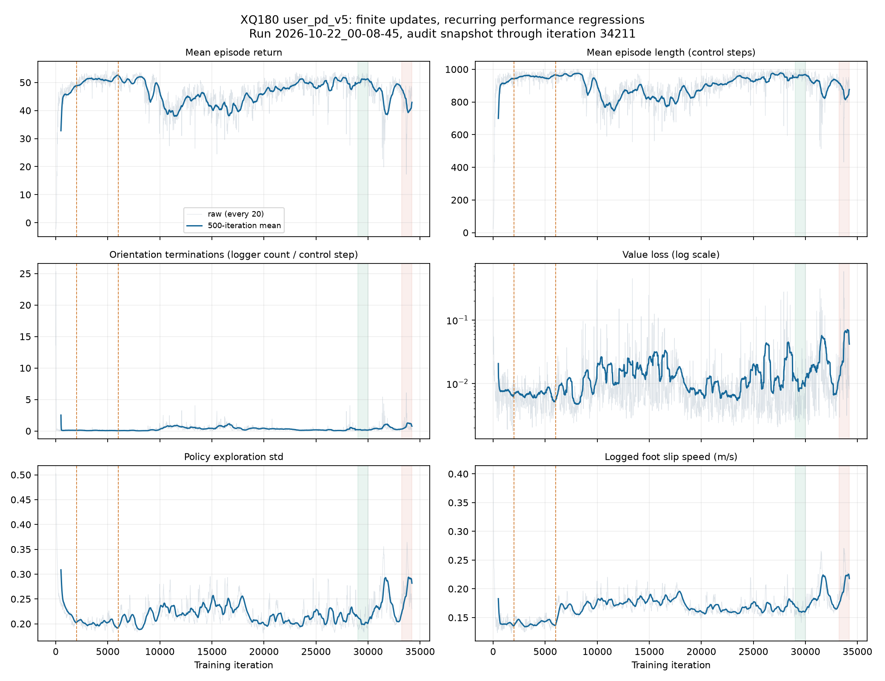

# XQ180 user_pd_v5 训练日志分析

> 此文记录修复前的 v5 训练。后续修复、checkpoint 迁移和新启动命令见 [AMP 修复说明](../../xq180_amp_fix.md)。

检查日期：2026-10-22。数据快照截至第 **34211** 轮，训练文件后续可能继续增长。主 run 为：

```text
logs/rsl_rl/xq180_amp_locomotion_no_recovery_userpd_v5/2026-10-22_00-08-45
```

同实验另一个 `2026-10-22_00-05-35` run 只有 27 轮记录，不能用于判断长期效果，也无法仅凭其事件文件确定退出原因。

## 结论

这次存在反复的策略性能退化，尚未出现上一个旧 run 那种非有限值导致更新停止的现象。当前证据最明确的直接表现是倾斜终止增多、episode 缩短、脚滑增加；同时 critic loss 和探索 std 上升。第 6000 轮扩大命令范围能解释一次即时变化，但 31000/33000 附近没有新的课程切换，后期反复下降还涉及训练更新过程。

还发现 AMP 归一化统计更新及梯度惩罚的输入尺度存在实现问题。应优先修复这些问题并做对照，再判断是否需要调整 PD。目前没有受控策略回放、KL 或动作饱和率记录，不能从日志确定单个关节 PD 是主因，也不能将一个实现问题认定为全部波动的唯一原因。



图中橙色虚线表示第 2000/6000 轮命令课程切换，绿色区间为 29000–30000，红色为 33212–34211；实线为 500 轮滑动均值。原始标量、分段均值和 checkpoint 检查摘要见 [summary.json](summary.json)。

## 已确认的运行配置与数值状态

保存的 `params/agent.yaml`、`params/env.yaml` 确认：

- 使用用户最新 PD：hip yaw 200/10、roll 400/20、pitch/knee 300/15、ankle 100/5、waist 100/5、shoulder pitch/roll 50/2、shoulder yaw/elbow 25/1。
- 专家库与 reset 都指向 `amp_ik/WalkandRun`，`recovery_dir=null`、延迟环境比例 0、最大延迟 0。爬起训练已关闭。
- 4096 个环境、每轮 24 步、目标 100000 轮；固定学习率 0.0003、初始噪声 std 0.5、执行动作裁剪 ±3。
- NaN guard 已启用，输出目录 `/tmp/mjlab/nan_dumps`；本次检查该目录未发现 dump 文件。沙箱可见性有限，无 dump 仅作辅助证据。
- 事件文件全部已记录标量均有限，`Loss/skipped_non_finite_batches` 从第 0 轮到 34211 始终为 0，记录学习率始终为 0.0003。
- 对 0、100、1000、5000、5900、10000、16000、20000、29000、32000、34100 checkpoint 做了 CPU 检查：策略、判别器、optimizer state 和归一化统计均有限，实际 optimizer 各参数组学习率均为 0.0003。
- actor 归一化计数从 0 轮的 98304，增长到 1000 轮的 98402304，之后在 100003840 停止，符合 `until=1e8` 的代码设定。此前导出器在第一轮就冻结 actor 归一化的缺陷，在本次 run 中没有复现。

## 性能如何变化

| 窗口 | 平均回报 | 平均 episode 步数 | 折合时长 | 倾斜终止日志计数 | Value loss | 探索 std | 脚滑日志值 |
|---|---:|---:|---:|---:|---:|---:|---:|
| 5500–5999 | 52.52 | 964.98 | 19.30 s | 0.0525 | 0.00534 | 0.1925 | 0.1369 m/s |
| 6000–6499 | 50.00 | 959.64 | 19.19 s | 0.0708 | 0.00953 | 0.2170 | 0.1734 m/s |
| 10000–11999 | 39.81 | 785.00 | 15.70 s | 0.7291 | 0.01484 | 0.2271 | — |
| 28000–29999 | 50.14 | 956.70 | 19.13 s | 0.2301 | 0.01563 | 0.2107 | 0.1680 m/s |
| 33212–34211 | 42.50 | 858.78 | 17.18 s | 0.8746 | 0.04509 | 0.2731 | 0.2104 m/s |

第 29000–29999 轮单独统计，回报为 51.17、episode 长度 965.54 步，说明在最终速度范围下仍曾达到较好状态。第 31000–31999 轮回报降至 41.63，32000–32999 又恢复到 48.52，33000–33999 再降至 42.78，属于反复退化。

必须注意指标的含义：

- `Episode_Termination/*` 是 reset 时的计数经 logger 平均后的指标，不是失败概率，不应把 0.8746 写成 87.46%。不同终止条件也可能同时触发。
- `Episode_Reward/*` 将 episode 累计奖励除以配置的 20 秒上限；episode 提前结束会同时压低多个奖励项，因此各项下降不等于每个奖励函数都单独出问题。
- `Metrics/twist/error_vel_xy/yaw` 是误差按最大命令时长 8 秒缩放后在 episode 内累积，episode 变短也会改变它。它们不能直接当作瞬时 m/s 或 rad/s 的平均跟踪误差。

## 原因与证据强度

### 1. 第 6000 轮课程切换增加了任务难度：已确认

第 2000 轮左右，vx 从 `[-0.3,0.8]` 扩至 `[-0.5,1.2]`；第 6000 轮左右进一步到 `[-0.8,1.8]`，vy 从 ±0.3 到 ±0.5，wz 从 ±0.75 到 ±1。紧随第 6000 轮，回报下降、脚滑和探索 std 上升。

课程按步数切换，不按任务成功率切换。因此在原先速度下表现好，不代表扩大范围后已准备充分。不过，后期 31000/33000 附近的退化发生在相同最终课程阶段，课程切换不能单独解释整条曲线。

### 2. AMP 归一化处理错误：源码与最小复现确认；训练影响待对照

在 [amp_ppo.py](../../../rsl_rl/algorithms/amp_ppo.py) 的 438–443 行，`policy_state`、`expert_state` 被替换为归一化后的张量；497–499 行随后把这些已经归一化的数据传给 `amp_normalizer.update()`。常规 running mean/variance 应用原始数据更新其统计。

用仓库现有 `Normalizer` 的最小复现：原始样本为 `[100,102,104,106]`，真实均值 103。先用原始数据更新统计得到均值约 103；随后按当前代码用标准化数据更新，统计均值移到约 51.50，即使原始数据分布根本没变。这证实其统计不再直接表示原始 AMP 特征分布。

同一处代码 449 行将原始 `sample_amp_expert` 输入梯度惩罚，而判别器损失使用归一化状态，正则项与主要判别区域的输入尺度不一致。另外，当前裁剪梯度的代码只覆盖 policy 参数，没有覆盖共同 optimizer 中的判别器参数。这些应一起复核，但目前 checkpoint 判别器参数仍有限，不能据此称判别器已数值爆炸。

建议先修复原始/归一化数据流和梯度惩罚尺度，记录判别器梯度范数，再做保持 PD 不变的对照。更改统计处理会改变判别器输入分布，加载旧 normalizer/optimizer 时需要一致的迁移方案。

### 3. 后期固定学习率下更新偏强：曲线支持，尚未证实

当前学习率 0.0003 全程固定，每轮 5 epochs ×4 mini-batches。性能下跌期间，value loss、探索 std、脚滑及倾斜终止同步上升；之后仍能恢复，符合策略更新波动的表现。当前未记录 KL、clip fraction、actor/discriminator 梯度范数，无法确认每次退化是否由过大更新触发。

建议在修复 AMP 数据流后的对照中测试后期 0.0001 或 0.00005，并记录 KL/clip fraction。若通过旧 checkpoint 续训，不能只修改 CLI 学习率就假定生效：当前 `load()` 会恢复 optimizer 的参数组学习率，而 fixed schedule 不会每次覆盖它；必须核对实际 optimizer 参数组的 LR。

### 4. 转向奖励约束偏宽：配置层面确认，行为影响待回放

角速度奖励的 std=3.14。只考虑 yaw 误差时，误差 0.5 rad/s 仍有约 `exp(-0.5²/3.14²)=0.975` 的奖励；误差 1 rad/s 仍约为 0.904。这对命令范围 ±0.5 到 ±1 rad/s 很宽，可能让站稳或滑动等行为获得较高任务分数，却不能严格跟随转向命令。

如果观察到“高分但转向不好”，优先用固定命令测试，再考虑 std=0.75–1.0。不能把这项配置直接认定为倾倒的唯一原因。

## 下一步建议

1. 保留当前用户 PD，先对比同一速度范围、无推扰条件下的 `model_29000.pt` / `model_30000.pt` 与 `model_34100.pt`。前 6000 轮的高分来自较窄命令范围，不适合直接与后期比较。
2. 优先修复 AMP 统计更新与梯度惩罚尺度，随后测试更小的后期学习率，并增加 KL、clip fraction、动作饱和率、关节/判别器梯度等日志。
3. 需要明确“走得好不好”时，分别测试站立、前进、后退、侧移和转向，统计存活率与每步真实速度误差。现有日志没有按命令和关节分组的结果，无法定位哪一类动作或哪个关节首先失稳。

本次检查生成了报告和图表，没有修改当前训练配置、PD 或运行中的任务。结论基于事件文件、保存配置、checkpoint 及代码审查；尚未进行受控策略回放或修复后的长期对照实验。
