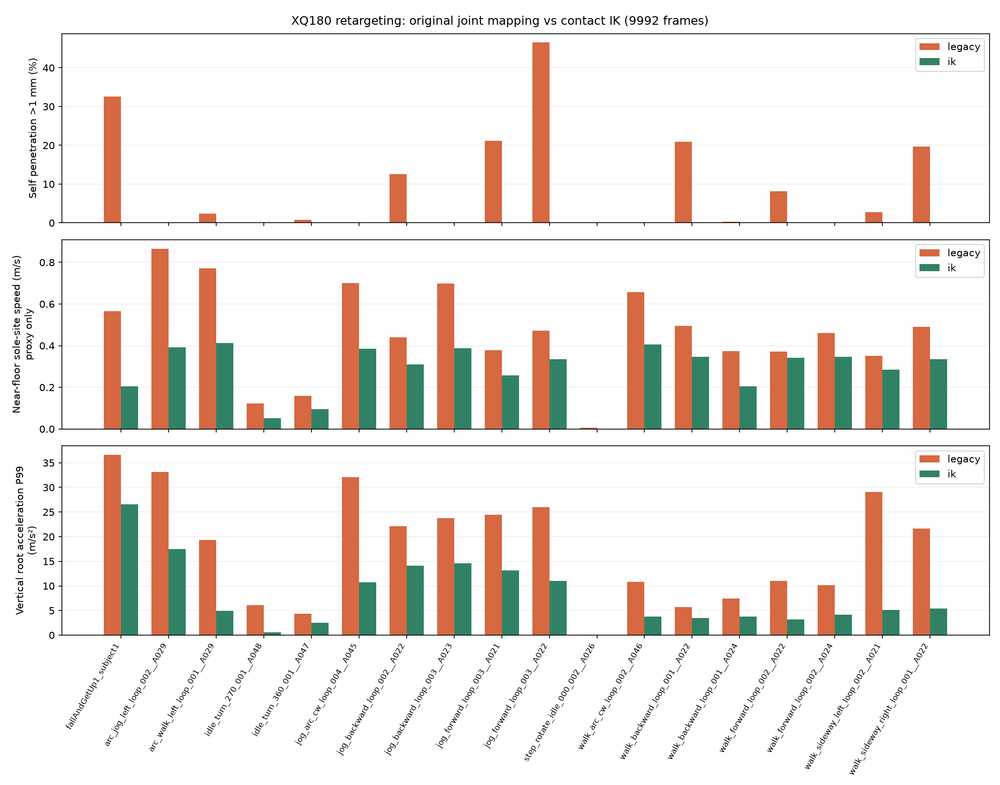
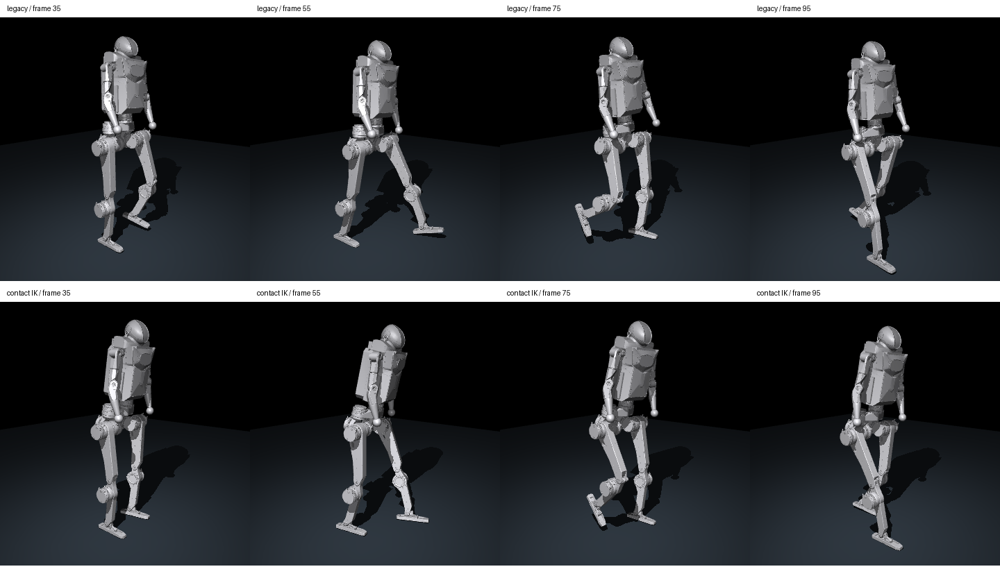
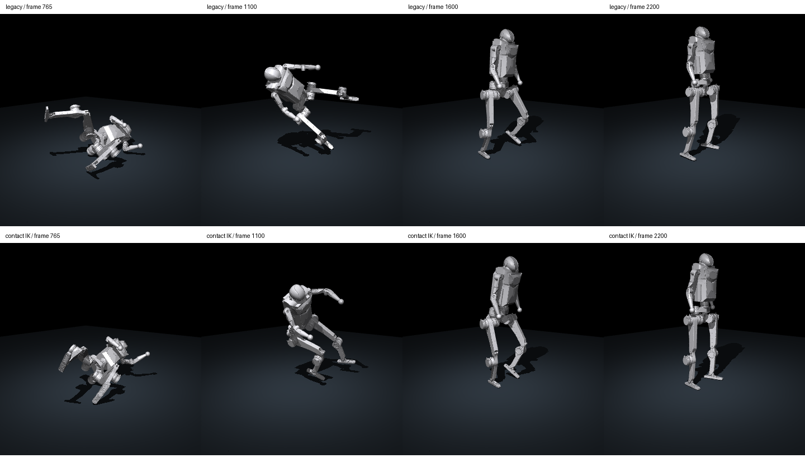

# G1 → XQ180 接触约束动作重定向

当前 AMP 训练使用 `ampfix_v6`，修复归一化与梯度处理，并增加分阶段学习率及 KL 停止。旧 checkpoint 的训练迁移见 [修复与续训说明](xq180_amp_fix.md)。

当前已把 18 段 G1 参考动作重新重定向到 XQ180：17 段走跑、1 段跌倒恢复，共 **9992 帧、50 Hz**，帧数和时间轴保持一致。全部转换产物保存在 `src/assets/motions/xq180/amp_ik/`。

当前训练仅使用 `amp_ik/WalkandRun/`：17 段、7417 帧；`Recovery/` 保留但不进入专家库或重置。PD 已采用用户指定 `user_pd_v5` 整数表，见 [当前仅行走方案](xq180_locomotion.md)。`python scripts/play_motions.py --speed 0.5` 默认播放这 17 段；显式传入 `--motion-dir src/assets/motions/xq180/amp_ik` 可回看全部转换产物。

## 结果

下表来自对保存后的全部 NPZ 逐帧重算与检查。完整数据见 [comparison.json](xq180_retarget/comparison.json)，逐段转换统计见 [retarget_report.json](../src/assets/motions/xq180/amp_ik/retarget_report.json)。

| 指标 | 原始关节映射 | 新接触 IK |
|---|---:|---:|
| reset 软限位会改变构型的帧 | 56.35% | 0% |
| 自穿透 >1 mm 的帧（当前碰撞模型） | 14.04% | 0% |
| 近地足底 site 水平速度均值 | 0.439 m/s | 0.270 m/s |
| 支撑脚位置目标误差均值 | 未拟合 | 1.74 mm |
| 最低碰撞几何离地间隙 | 逐帧贴地 | ≥2 mm |
| 最大关节速度 / URDF 额定速度 | — | 0.908 |

近地足底 site 的阈值为高度 `<35 mm`，水平速度由其轨迹差分计算。这个滑移代理指标全库平均下降约 38.6%，但它也包含脚掌转动和离地过渡，不能当作物理接触滑移的实测值。支撑脚目标误差是相对于算法调整后的可达脚轨迹，不是对 G1 原脚轨迹的毫米级复现。



姿态预览上排为原始映射，下排为新 IK。每个姿态均将根 XY 与整体 yaw 对齐以方便比较；这是几何回放，不是策略闭环结果。





## 方法

1. 在 G1 上重新计算足底位姿、躯干朝向和上下臂方向；关节名称映射及肘部 +π/2 固定坐标旋转补偿用于初始姿态。
2. 根据两台机器人名义站姿的根到足底高度确定竖直比例（约 1.3804），根据髋/足位置增加目标侧向间距。行走目标脚保持在本侧，避免复制无法在较宽 XQ180 脚上复现的交叉步。
3. 由源脚高度、竖直速度和根姿态识别近地支撑阶段，为每段建立稳定足底位置和姿态目标。长时间原地转向允许分段枢转，避免把一只脚固定整个 360° 转向。
4. 用 MuJoCo Jacobian 和带 box 约束的最小二乘，逐帧求解浮动根及 19 个关节。目标包含脚位置/姿态、躯干朝向、上下臂方向、根轨迹和时间连续性；根 XY 和朝向是软目标，可为目标结构的可达性适当调整。
5. 在求解内使用与 reset 一致的 0.9 软限位和关节速度边界。自碰撞与地面距离加入不等式惩罚；平滑后再次投影修复残留碰撞，按精确碰撞几何边界抬升一个平滑包络，使最终最低点保留 2 mm 间隙。
6. 从最终姿态重新计算全部 20 个连杆的 FK、19 关节速度、世界系连杆原点线速度和角速度。最终数据不再使用旧映射的速度。

恢复片段在倾倒阶段更重视全身与地面、躯干和手臂几何，支撑脚锁定只在符合直立/近地条件时使用。XQ180 少了 G1 的 ankle roll、waist roll/pitch 和腕关节，因此部分姿态必然需要改变。

## 生成、复核与训练

在仓库根目录执行：

```bash
conda activate mjlab

# 默认使用接触 IK，生成 WalkandRun 和 Recovery。
python scripts/retarget_g1_to_xq180.py

# 对保存后的整库重算指标，生成对比 JSON/图表。
python scripts/validate_xq180_ik.py

# 可用 EGL 的环境中额外生成 MuJoCo 姿态预览。
MUJOCO_GL=egl python scripts/validate_xq180_ik.py --render

python -m unittest discover -s tests -v

# 使用新动作和整数 PD、仅行走数据启动一个新 run。
python scripts/train.py XQ180-AMP-Flat --env.scene.num-envs=4096
```

新 AMP 日志目录为 `logs/rsl_rl/xq180_amp_locomotion_no_recovery_userpd_v5_ampfix_v6/`。`XQ180-AMP-Rough` 同样使用新动作库；普通速度任务不依赖动作数据。

可以指定 `--source-dir`、`--output-dir` 和 `--iterations`（默认 18）。原始关节映射保留在 `src/assets/motions/xq180/amp/`，需要重建对照数据时显式执行：

```bash
python scripts/retarget_g1_to_xq180.py --method joint-map
```

该对照命令写入旧 `amp/`，不会切换当前训练数据目录。已启动进程通常缓存动作，切换到新数据需重启训练/回放环境。

## 验证范围

历史阶段 25 项回归检查通过，覆盖原有 Hunter 回归、该阶段腿部阻尼 PD、18 段数据的帧率/顺序/软限位/速度、保存后的全帧地面与自碰撞、采样帧 FK 和连杆速度一致性，以及小片段实际转换与原子写入。AMP Flat/Rough 均通过 CPU 环境初始化、重置和有限步进，源数据和旧对照库保留。

这些动作经过运动学约束优化，尚未求解质心平衡、接触力、摩擦锥或逆动力学。恢复动作的根部竖直加速度 P99 仍约 26.6 m/s²；碰撞/限位可接受不表示能在当前 PD 下稳定跟踪或站起。尚未验证新动作下的 GPU 长时间训练、收敛提升和实机效果。

源码：[求解器](../scripts/xq180_retarget_ik.py)、[转换入口](../scripts/retarget_g1_to_xq180.py)、[数据复核](../scripts/validate_xq180_ik.py)、[统一动作路径](../src/tasks/amp_loco/config/xq180/motion.py)。
